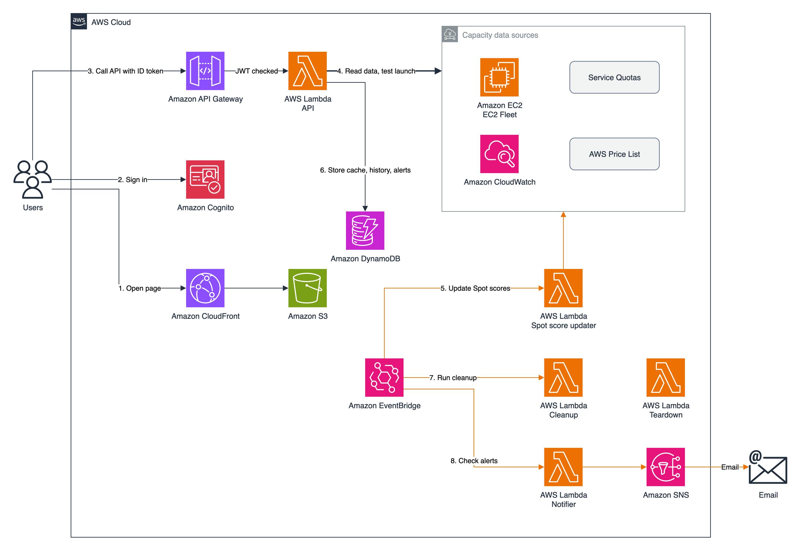

# GPU Capacity Finder

> This is sample code, for non-production usage. You should work with your security and legal teams to meet your organizational security, regulatory and compliance requirements before deployment.

GPU Capacity Finder is a small decision-support web application that you deploy in your own AWS account to find GPU capacity on Amazon Elastic Compute Cloud (Amazon EC2). One page shows the public capacity signals: Capacity Block offerings, Spot placement scores, Spot prices, On-Demand list prices, and service quotas with their usage. You can check a signal with one bounded test launch and set optional email alerts. The page does not manage instances, reserve capacity, or launch your workloads. When you decide to act, you buy a Capacity Block in the EC2 console, and the page gives you an AWS Command Line Interface (AWS CLI) command to create a Capacity Reservation that you run yourself.

## Problem it solves

GPU instances such as P5 and P6 are in high demand. You often ask: Is a Capacity Block available, and when? Is Spot likely to work in this Region? Does On-Demand have capacity right now? Do I have enough quota? Public AWS APIs answer the first, second, and fourth question. No API reports On-Demand capacity, so the test launch asks for one instance, terminates it right after the launch call, and keeps the result as history.

## Architecture



1. You open the page from an Amazon CloudFront distribution. The page is static HTML and JavaScript in a private Amazon Simple Storage Service (Amazon S3) bucket.
2. You sign in through the Amazon Cognito hosted page. Self sign-up is off, an administrator creates each user, and multi-factor authentication (MFA) with an authenticator app is required.
3. The page calls an Amazon API Gateway HTTP API with your ID token. A JSON Web Token (JWT) authorizer checks the token before the API function in AWS Lambda runs.
4. The API function reads Amazon EC2, Service Quotas, Amazon CloudWatch, and AWS Price List data in the enabled Regions, and runs test launches with EC2 Fleet.
5. The Spot score updater function runs every 15 minutes on an Amazon EventBridge schedule, with a daily update at 00:30 UTC. It is the only code that creates Spot placement score requests.
6. Amazon DynamoDB tables store the shared cache (offerings, scores, prices, and quotas), the test launch history, and the email alerts.
7. A cleanup function terminates leftover test instances every 15 minutes, and a teardown function removes the test resources when you delete the stack.
8. A notifier function checks the alerts on a schedule and sends email through an Amazon Simple Notification Service (Amazon SNS) topic.

The sample uses Python for the infrastructure (AWS Cloud Development Kit, or AWS CDK), the Lambda functions, and the tests. The page is plain JavaScript with no build step.

## Prerequisites

- An AWS account and credentials that can deploy the stack. Use a non-production account.
- One deployment of this sample per AWS account. See [Teardown](#teardown) for the reason.
- AWS CLI version 2, Node.js 20 or later with `npm install -g aws-cdk`, and Python 3.12 or later.
- The CDK bootstrapped in the deploy Region. From the sample root, run `python3 -m venv .venv && source .venv/bin/activate && pip install -r requirements.txt && cdk bootstrap`.
- A default virtual private cloud (VPC) in each Region where you want to run test launches. To create one, run `aws ec2 create-default-vpc --region <Region>`.
- For Spot test launches, Spot access and the Spot service-linked role: `aws iam create-service-linked-role --aws-service-name spot.amazonaws.com`. If your account cannot use Spot, set `testLaunchAllowSpot=false`.

## Deploy

From the sample root, run:

```bash
export AWS_PROFILE=<profile>   # or sign in another way
export AWS_REGION=<region>
./deploy.sh
```

The script creates the Python environment, asks you to confirm the account and Region, and runs `cdk deploy`. Pass settings after the script name, such as `./deploy.sh -c excludeRegions=me-south-1`. If you upgrade a stack that an earlier version created, read [Upgrade](docs/admin-guide.md#upgrade) first: the deploy stops when you pass a removed or renamed setting.

The deploy prints `SiteUrl` and `UserPoolId`. Create your first user:

```bash
aws cognito-idp admin-create-user --region <StackRegion> --user-pool-id <UserPoolId> \
  --username you@example.com \
  --user-attributes Name=email,Value=you@example.com Name=email_verified,Value=true \
  --desired-delivery-mediums EMAIL
```

Open `SiteUrl`, sign in with the temporary password, set a new password, and enroll an authenticator app.

To run the unit tests, run `pip install -r requirements-dev.txt && pytest` in the Python environment.

### Settings

Pass each setting with `-c key=value`. Pass the same settings on each deploy. The [administrator guide](docs/admin-guide.md#settings) explains when to change each one.

| Key | Default | Meaning |
|---|---|---|
| `stackName` | `gpu-capacity-finder` | Up to 40 letters, digits, and hyphens, starting with a letter, without `aws`, `amazon`, or `cognito` |
| `excludeRegions` | none | Up to 40 enabled Regions to leave out of the features. `us-east-1` is refused because Spot score requests go to its endpoint |
| `spotScoreFamilies` | `g6e.*`, `g7.*`, `g7e.*`, `p5.*`, `p5e.*`, `p5en.*`, `p6-b200.*`, `p6-b300.*` | Up to 20 patterns for the families that get Spot scores. See [Choose the Spot score families](#choose-the-spot-score-families) |
| `spotScoreConfigsPerDay` | `40` | 1 to 100. Most different Spot score request configurations in use in 24 hours |
| `spotScoreCacheMinutes` | `15` | 15 to 240. Minutes a score stays current |
| `enableTestLaunch` | `true` | `false` removes the test launch, its permissions, and the cleanup and teardown functions |
| `testLaunchAllowSpot` | `true` | `false` hides and refuses the Spot test launch |
| `testLaunchCooldownMinutes` | `15` | 1 to 1440. A repeat test in this time returns the earlier result |
| `maxTestLaunchesPerUserPerDay` | `50` | 0 to 1000. Test launches per user per UTC day; `0` turns the cap off |
| `maxTestLaunchesPerDay` | `100` | 0 to 10000. Test launches for the whole deployment per UTC day; `0` turns the cap off |
| `enableNotifications` | `true` | `false` removes the alert table, SNS topic, notifier, and **Alerts** tab |
| `notifyIntervalMinutes` | `15` | 5 to 1440. Minutes between alert checks |
| `maxSubscriptionsPerUser` | `10` | 1 to 20. Alerts per user |
| `offeringCacheHours` | `6` | 1 to 48. Hours the offering list stays cached |
| `quotaCacheMinutes` | `30` | 1 to 60. Minutes a Region's quotas stay cached |
| `apiRateLimit` | `10` | 1 to 100. API requests per second, shared by users; the burst is three times this value |
| `sessionHours` | `12` | 1 to 720. Hours before the next full sign-in |
| `alarmTopicArn` | unset | ARN of an SNS topic you own, in the stack Region, for CloudWatch alarms. See [Alarms](docs/admin-guide.md#alarms) |

When both daily test launch caps are `0`, only the cooldown and the API rate limit control how many test launches run, and so how much they cost.

The features use the commercial Regions your account has enabled, minus `excludeRegions`. A Region you enable appears within a day without a redeploy. See [Regions](docs/admin-guide.md#regions).

### Choose the Spot score families

AWS restricts how many different Spot placement score requests an account can make in 24 hours, and everything in the account shares that restriction. Each scored family costs one request per GPU count and per 10 Regions that sell it. Scoring each GPU type in each Region would exceed it, so list only the GPU families you need in `spotScoreFamilies`. To change the default list, pass the full list, quoted for your shell:

```bash
./deploy.sh -c 'spotScoreFamilies=g6e.*,p5en.*,p6-b200.*'
```

Each pattern starts with a `g` or `p` family letter and its generation digit and contains a dot, star, or question mark, such as `g6e.*` or `p5*`. Patterns without the digit, such as `g*`, are refused.

- **Updates automatically.** A new size of a scored family, and a Region that you enable or that starts to sell a size, join their score group at the next daily update. Supply, prices, quotas, test launches, and Capacity Blocks cover each GPU family and pick up new families on their own.
- **Needs a change and a redeploy.** A new family gets no Spot score until you add it to `spotScoreFamilies` and deploy again.

See [How Spot scores stay current](docs/admin-guide.md#how-spot-scores-stay-current) for the refresh cycle.

## Use

The page has six tabs: **Spot score**, **On-Demand and Spot**, **Capacity Blocks**, **Quotas**, **Alerts** (only with email alerts on), and **Users**. Users of a deployment share the same answers.

- **Spot score** compares Regions for each score group (one family with one GPU count) as a table or a map.
- **On-Demand and Spot** shows one type in one Region: the On-Demand list price, the Spot score, Spot prices per zone, and the test launch panel. A test launch reports the zone and size that EC2 picked, or why it found no capacity. **Reserve with CLI** on a zone row gives you an AWS CLI command for an On-Demand Capacity Reservation: it holds capacity for one instance of that type in that zone for one hour, and it bills at the On-Demand rate until it ends or you cancel it. The page does not create it.
- **Capacity Blocks** searches offerings and links each one to the EC2 console, where you buy it.
- **Quotas** shows the On-Demand, Spot, and Capacity Block quotas of a Region with their usage. Usage comes from Amazon CloudWatch and can take a few minutes to show a new instance. The page shows the highest value in the last hour and keeps it for up to `quotaCacheMinutes` minutes; choose **Refresh** to ask again.
- **Alerts** emails you when an offering appears or a Spot score reaches your threshold. An alert emails you once each time it changes from not available to available. When the signal drops below your threshold and comes back, for example a score that moves between 3 and 4 around a threshold of 4, you get another email.
- **Users** explains how to manage users in the Amazon Cognito console.

The [user guide](docs/user-guide.md) describes each tab and gives worked scenarios, and the [administrator guide](docs/admin-guide.md) covers settings, users, monitoring, and upgrades. Direct translations are available in Simplified Chinese ([README](README.zh-cn.md), [user guide](docs/user-guide.zh-cn.md), [administrator guide](docs/admin-guide.zh-cn.md)) and Traditional Chinese ([README](README.zh-tw.md), [user guide](docs/user-guide.zh-tw.md), [administrator guide](docs/admin-guide.zh-tw.md)).

## Teardown

The resources in this sample incur charges while they run, including the GPU instances that test launches start. An On-Demand test launch is billed for the minimum billing period of its type.

```bash
source .venv/bin/activate   # the CDK app needs the Python environment that deploy.sh creates
cdk destroy                 # add -c stackName=<name> if you deployed with a custom stack name
```

`cdk destroy` removes the S3 bucket contents, the DynamoDB tables, the SNS topic with its subscriptions, the user pool, and the function log groups. When test launches are on, a teardown custom resource terminates running test instances and removes the probe launch templates and probe security groups in the enabled Regions minus `excludeRegions`. A Region that fails does not block the delete. After the delete, check:

- **Probe resources** in each Region where you ran test launches: instances and launch templates tagged `gpu-capacity-finder-probe`, and security groups tagged `gpu-capacity-finder-probe-sg`. The custom resource skips a Region that you excluded after testing there.
- **DynamoDB system backups.** DynamoDB keeps a system backup of each deleted table for 35 days, and the alert table backup holds user email addresses.
- **Log groups of CDK helper functions.**
- **Capacity Blocks** that users bought in the EC2 console, and **Capacity Reservations** that users created with the copied commands. The stack does not own them, and they keep billing.

The [administrator guide](docs/admin-guide.md#teardown) has the commands for each check.

Use one deployment of this sample per AWS account. The probe resources use fixed tag names, and the cleanup and teardown functions scan the enabled Regions of the account, so a second deployment in the same account, even in another Region, would clean up the test resources of the first one. The AWS restriction on Spot placement score requests is also shared by the whole account.

## Limitations

- A Spot placement score is an estimate, and a group score describes the group, not one size. A high score does not promise a launch, and a low score can still launch.
- The sample cannot raise the AWS restriction on Spot score requests (see [Choose the Spot score families](#choose-the-spot-score-families)).
- Capacity answers are point-in-time. Email alerts check on a schedule, so a signal can come and go between two checks.
- Prices are list prices and the latest Spot prices. What you pay can differ, for example with discounts or Savings Plans.
- Test launches use the default VPC and are off in a Region without one.
- Quota usage can lag by a few minutes and covers only the account where you deploy. For several accounts, deploy one copy per account.
- The page has no AWS WAF web access control list (web ACL), no custom domain, and no access logging. Add them before you share the page widely.

## Security

Each AWS Identity and Access Management (IAM) role is scoped to its function. The API function has read-only Amazon EC2, Service Quotas, CloudWatch, and Price List actions. Its test launch permissions require the probe tag, `g*` or `p*` instance types, Amazon-owned images, and the tagged probe security group. No role can create Capacity Reservations or buy Capacity Blocks. The [administrator guide](docs/admin-guide.md#security-notes) lists each permission.

See [CONTRIBUTING](CONTRIBUTING.md#security-issue-notifications) for more information.

## License

This library is licensed under the MIT-0 License. See the [LICENSE](LICENSE) file.

The world outline of the Region map comes from Natural Earth, which is in the public domain. See the [THIRD-PARTY-LICENSES](THIRD-PARTY-LICENSES) file.
