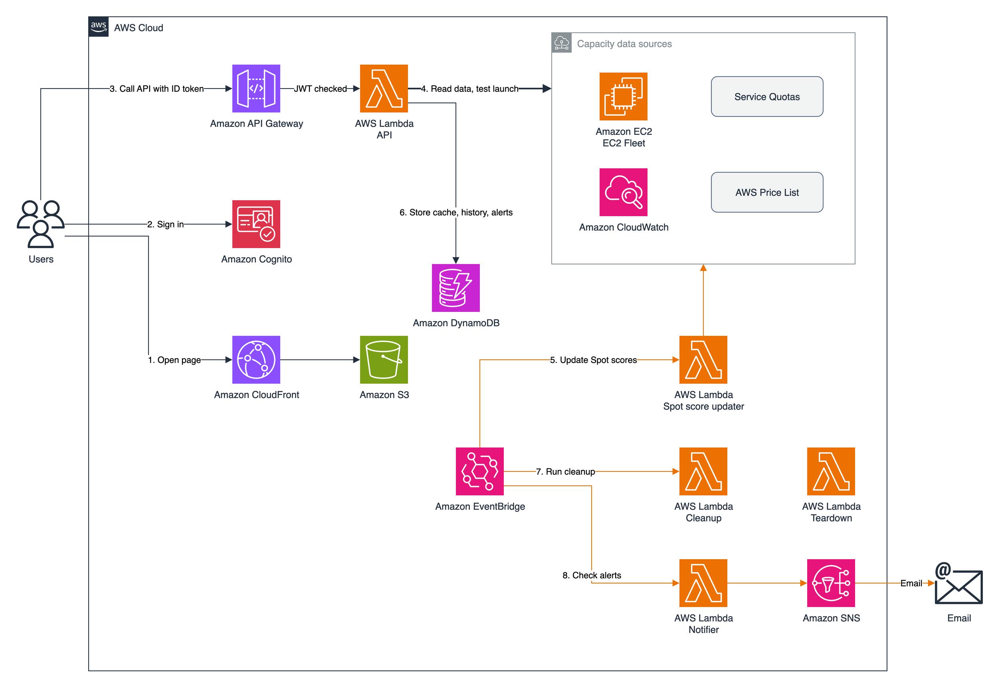

# GPU Capacity Finder

> 本文档是[英文版 README](README.md) 的直译，不含额外内容。如有出入，以英文版为准。

GPU Capacity Finder 是一个小型的决策辅助 Web 应用，您将它部署在自己的 AWS 账户中，用来查找 Amazon Elastic Compute Cloud（Amazon EC2）上的 GPU 容量。一个页面显示公开的容量信号：Capacity Block 方案、Spot 放置分数、Spot 价格、按需定价，以及服务配额及其用量。您可以用一次有边界的测试启动来验证某个信号，并设置可选的电子邮件提醒。该页面不管理实例，不预留容量，也不启动您的工作负载。当您决定行动时，您在 EC2 控制台中购买 Capacity Block，而页面会给出创建 Capacity Reservation 的 AWS Command Line Interface（AWS CLI）命令，由您自己执行。

## 解决的问题

P5、P6 等 GPU 实例需求旺盛。您经常会问：有可用的 Capacity Block 吗？什么时候？在这个区域中 Spot 大概率能成功吗？按需现在有容量吗？我的配额够吗？公开的 AWS API 可以回答第一、第二和第四个问题。没有 API 报告按需容量，因此测试启动会请求一个实例，在启动调用之后立即终止它，并把结果保存为历史记录。

## 架构



1. 您通过 Amazon CloudFront 分配打开页面。页面是静态 HTML 和 JavaScript，存放在私有的 Amazon Simple Storage Service（Amazon S3）存储桶中。
2. 您通过 Amazon Cognito 托管页面登录。自助注册已关闭，每位用户由管理员创建，并且必须使用身份验证器应用进行多重身份验证（MFA）。
3. 页面使用您的 ID 令牌调用 Amazon API Gateway HTTP API。在 AWS Lambda 中的 API 函数运行之前，JSON Web Token（JWT）授权方会先检查该令牌。
4. API 函数读取已启用区域中的 Amazon EC2、Service Quotas、Amazon CloudWatch 和 AWS Price List 数据，并使用 EC2 Fleet 执行测试启动。
5. Spot 分数更新函数按 Amazon EventBridge 计划每 15 分钟运行一次，并在 00:30 UTC 进行每日更新。它是唯一创建 Spot 放置分数请求的代码。
6. Amazon DynamoDB 表保存共享缓存（方案、分数、价格和配额）、测试启动历史和电子邮件提醒。
7. 清理函数每 15 分钟终止一次遗留的测试实例，拆除函数会在您删除堆栈时移除测试资源。
8. 通知器函数按计划检查提醒，并通过 Amazon Simple Notification Service（Amazon SNS）主题发送电子邮件。

本示例的基础设施（AWS Cloud Development Kit，即 AWS CDK）、Lambda 函数和测试都使用 Python。页面是纯 JavaScript，没有构建步骤。

## 前提条件

- 一个 AWS 账户，以及可以部署该堆栈的凭证。请使用非生产账户。
- 每个 AWS 账户只部署一份本示例。原因请参阅[拆除](#拆除)。
- AWS CLI 第 2 版、Node.js 20 或更高版本（并执行 `npm install -g aws-cdk`），以及 Python 3.12 或更高版本。
- 在部署区域中完成 CDK bootstrap。在示例根目录中运行 `python3 -m venv .venv && source .venv/bin/activate && pip install -r requirements.txt && cdk bootstrap`。
- 在您要执行测试启动的每个区域中都有一个默认虚拟私有云（VPC）。要创建默认 VPC，请运行 `aws ec2 create-default-vpc --region <Region>`。
- 对于 Spot 测试启动，需要 Spot 访问权限和 Spot 服务相关角色：`aws iam create-service-linked-role --aws-service-name spot.amazonaws.com`。如果您的账户无法使用 Spot，请设置 `testLaunchAllowSpot=false`。

## 部署

在示例根目录中运行：

```bash
export AWS_PROFILE=<profile>   # or sign in another way
export AWS_REGION=<region>
./deploy.sh
```

该脚本会创建 Python 环境，请您确认账户和区域，然后运行 `cdk deploy`。在脚本名称之后传入设置，例如 `./deploy.sh -c excludeRegions=me-south-1`。如果您要升级由早期版本创建的堆栈，请先阅读[升级](docs/admin-guide.zh-cn.md#升级)：当您传入已移除或已重命名的设置时，部署会停止。

部署会输出 `SiteUrl` 和 `UserPoolId`。创建您的第一位用户：

```bash
aws cognito-idp admin-create-user --region <StackRegion> --user-pool-id <UserPoolId> \
  --username you@example.com \
  --user-attributes Name=email,Value=you@example.com Name=email_verified,Value=true \
  --desired-delivery-mediums EMAIL
```

打开 `SiteUrl`，使用临时密码登录，设置新密码，并注册一个身份验证器应用。

要运行单元测试，请在 Python 环境中运行 `pip install -r requirements-dev.txt && pytest`。

### 设置

使用 `-c key=value` 传入每项设置。每次部署时请传入相同的设置。[管理员指南](docs/admin-guide.zh-cn.md#设置)说明了何时需要修改每一项。

| 键 | 默认值 | 含义 |
|---|---|---|
| `stackName` | `gpu-capacity-finder` | 最多 40 个字母、数字和连字符，以字母开头，不能包含 `aws`、`amazon` 或 `cognito` |
| `excludeRegions` | 无 | 最多 40 个要从各项功能中排除的已启用区域。`us-east-1` 会被拒绝，因为 Spot 分数请求发送到它的端点 |
| `spotScoreFamilies` | `g6e.*`、`g7.*`、`g7e.*`、`p5.*`、`p5e.*`、`p5en.*`、`p6-b200.*`、`p6-b300.*` | 最多 20 个模式，用于指定获取 Spot 分数的系列。请参阅[选择 Spot 分数系列](#选择-spot-分数系列) |
| `spotScoreConfigsPerDay` | `40` | 1 到 100。24 小时内使用中的不同 Spot 分数请求配置的最大数量 |
| `spotScoreCacheMinutes` | `15` | 15 到 240。分数保持最新的分钟数 |
| `enableTestLaunch` | `true` | `false` 会移除测试启动、其权限，以及清理函数和拆除函数 |
| `testLaunchAllowSpot` | `true` | `false` 会隐藏并拒绝 Spot 测试启动 |
| `testLaunchCooldownMinutes` | `15` | 1 到 1440。在此时间内重复测试会返回先前的结果 |
| `maxTestLaunchesPerUserPerDay` | `50` | 0 到 1000。每位用户每个 UTC 日的测试启动次数；`0` 表示关闭上限 |
| `maxTestLaunchesPerDay` | `100` | 0 到 10000。整个部署每个 UTC 日的测试启动次数；`0` 表示关闭上限 |
| `enableNotifications` | `true` | `false` 会移除提醒表、SNS 主题、通知器和 **提醒** 标签页 |
| `notifyIntervalMinutes` | `15` | 5 到 1440。两次提醒检查之间的分钟数 |
| `maxSubscriptionsPerUser` | `10` | 1 到 20。每位用户的提醒数量 |
| `offeringCacheHours` | `6` | 1 到 48。方案列表保持缓存的小时数 |
| `quotaCacheMinutes` | `30` | 1 到 60。一个区域的配额保持缓存的分钟数 |
| `apiRateLimit` | `10` | 1 到 100。每秒 API 请求数，由用户共用；突发额度是该值的三倍 |
| `sessionHours` | `12` | 1 到 720。下次需要完整登录之前的小时数 |
| `alarmTopicArn` | 未设置 | 您拥有的、位于堆栈区域中的 SNS 主题的 ARN，用于 CloudWatch 告警。请参阅[告警](docs/admin-guide.zh-cn.md#告警) |

两个每日测试启动上限都设为 `0` 时，只剩冷却时间和 API 速率限制会限制测试启动的次数，也就是限制它们的费用。

各项功能使用您的账户已启用的商业区域，减去 `excludeRegions`。您启用的区域会在一天内出现，无需重新部署。请参阅[区域](docs/admin-guide.zh-cn.md#区域)。

### 选择 Spot 分数系列

AWS 会限制一个账户在 24 小时内可发出的不同 Spot 放置分数请求数量，账户中的各项内容共用这一限制。每个获取分数的系列，按每个 GPU 数量以及销售它的每 10 个区域，各占用一个请求。为每个区域中的每种 GPU 类型获取分数会超出该限制，因此请只在 `spotScoreFamilies` 中列出您需要的 GPU 系列。要更改默认列表，请传入完整列表，并按您的 shell 要求加引号：

```bash
./deploy.sh -c 'spotScoreFamilies=g6e.*,p5en.*,p6-b200.*'
```

每个模式以 `g` 或 `p` 系列字母及其代数字开头，并包含点、星号或问号，例如 `g6e.*` 或 `p5*`。像 `g*` 这样没有代数字的模式会被拒绝。

- **自动更新。** 已获取分数的系列的新规格，以及您启用的区域或开始销售某个规格的区域，会在下一次每日更新时加入其分数组。供应、价格、配额、测试启动和 Capacity Block 涵盖每个 GPU 系列，并会自行纳入新系列。
- **需要修改并重新部署。** 新系列在您将其添加到 `spotScoreFamilies` 并再次部署之前，不会获得 Spot 分数。

刷新周期请参阅 [Spot 分数如何保持最新](docs/admin-guide.zh-cn.md#spot-分数如何保持最新)。

## 使用

页面有六个标签页：**Spot 分数**、**按需与 Spot**、**Capacity Block**、**配额**、**提醒**（仅在电子邮件提醒开启时显示）和 **用户**。同一部署的用户共享相同的答案。

- **Spot 分数** 以表格或地图的形式，按每个分数组（一个系列加一个 GPU 数量）比较各区域。
- **按需与 Spot** 显示一个区域中的一个类型：按需定价、Spot 分数、各可用区的 Spot 价格，以及测试启动面板。测试启动会报告 EC2 选择的可用区和规格，或找不到容量的原因。可用区行上的**使用 CLI 预留**会提供一个创建按需容量预留（On-Demand Capacity Reservation）的 AWS CLI 命令：它在该可用区为该类型保留一个实例的容量一小时，并以按需费率计费，直到它结束或您取消为止。此页面不会替您创建。
- **Capacity Block** 搜索方案，并将每个方案链接到 EC2 控制台，供您在那里购买。
- **配额** 显示一个区域的按需、Spot 和 Capacity Block 配额及其用量。用量来自 Amazon CloudWatch，新实例可能要几分钟后才会显示。页面显示最近一小时内的最高值，并保留最多 `quotaCacheMinutes` 分钟；选择**刷新**即可再次查询。
- **提醒** 在出现方案或 Spot 分数达到您的阈值时向您发送电子邮件。提醒每次从不可用变为可用时发送一封电子邮件。信号降到阈值以下后又恢复时，您会再收到一封，例如阈值为 4，而分数在 3 和 4 之间变动。
- **用户** 说明如何在 Amazon Cognito 控制台中管理用户。

[用户指南](docs/user-guide.zh-cn.md)介绍了每个标签页并给出示例场景，[管理员指南](docs/admin-guide.zh-cn.md)涵盖设置、用户、监控和升级。提供简体中文（[README](README.zh-cn.md)、[用户指南](docs/user-guide.zh-cn.md)、[管理员指南](docs/admin-guide.zh-cn.md)）和繁体中文（[README](README.zh-tw.md)、[用户指南](docs/user-guide.zh-tw.md)、[管理员指南](docs/admin-guide.zh-tw.md)）的直译版本。

## 拆除

本示例中的资源在运行期间会产生费用，包括测试启动所启动的 GPU 实例。按需测试启动按其实例类型的最短计费时长计费。

```bash
source .venv/bin/activate   # the CDK app needs the Python environment that deploy.sh creates
cdk destroy                 # add -c stackName=<name> if you deployed with a custom stack name
```

`cdk destroy` 会移除 S3 存储桶内容、DynamoDB 表、带有订阅的 SNS 主题、用户池，以及函数的日志组。当测试启动开启时，一个拆除自定义资源会在已启用的区域（减去 `excludeRegions`）中终止运行中的测试实例，并移除探测启动模板和探测安全组。某个区域失败不会阻止删除。删除之后，请检查：

- **探测资源**：在您执行过测试启动的每个区域中，检查带有 `gpu-capacity-finder-probe` 标签的实例和启动模板，以及带有 `gpu-capacity-finder-probe-sg` 标签的安全组。如果您在某个区域测试之后才将它排除，自定义资源会跳过该区域。
- **DynamoDB 系统备份。** DynamoDB 会为每个已删除的表保留系统备份 35 天，而提醒表的备份包含用户的电子邮件地址。
- **CDK 辅助函数的日志组。**
- 用户在 EC2 控制台中购买的 **Capacity Block**，以及用户使用复制的命令创建的 **Capacity Reservation**。堆栈并不拥有它们，它们会继续计费。

[管理员指南](docs/admin-guide.zh-cn.md#拆除)提供了每项检查的命令。

每个 AWS 账户只部署一份本示例。探测资源使用固定的标签名称，而清理函数和拆除函数会扫描账户中已启用的区域，因此在同一账户中的第二个部署（即使位于另一个区域）会清理掉第一个部署的测试资源。AWS 对 Spot 放置分数请求的限制也由整个账户共用。

## 限制

- Spot 放置分数是一种估计，分数组的分数描述的是整个组，而不是单个规格。高分不代表一定能启动，低分也仍有可能启动。
- 本示例无法提高 AWS 对 Spot 分数请求的限制（请参阅[选择 Spot 分数系列](#选择-spot-分数系列)）。
- 容量答案只反映某一时间点。电子邮件提醒按计划检查，因此某个信号可能在两次检查之间出现又消失。
- 价格是定价和最新的 Spot 价格。您实际支付的金额可能不同，例如因折扣或 Savings Plans。
- 测试启动使用默认 VPC，在没有默认 VPC 的区域中会关闭。
- 配额用量可能滞后几分钟，并且只涵盖您部署所在的账户。如果有多个账户，请在每个账户各部署一份。
- 页面没有 AWS WAF Web 访问控制列表（Web ACL）、自定义域名和访问日志。在广泛分享页面之前，请先添加它们。

## 安全

每个 AWS Identity and Access Management（IAM）角色都限定于其函数。API 函数拥有只读的 Amazon EC2、Service Quotas、CloudWatch 和 Price List 操作。它的测试启动权限要求带有探测标签、使用 `g*` 或 `p*` 实例类型、使用 Amazon 拥有的映像，以及使用带标签的探测安全组。没有任何角色可以创建 Capacity Reservation 或购买 Capacity Block。[管理员指南](docs/admin-guide.zh-cn.md#安全说明)列出了每项权限。

更多信息请参阅 [CONTRIBUTING](CONTRIBUTING.md#security-issue-notifications)。

## 许可证

本库采用 MIT-0 许可证。请参阅 [LICENSE](LICENSE) 文件。

区域地图的世界轮廓来自 Natural Earth，属于公有领域。请参阅 [THIRD-PARTY-LICENSES](THIRD-PARTY-LICENSES) 文件。
