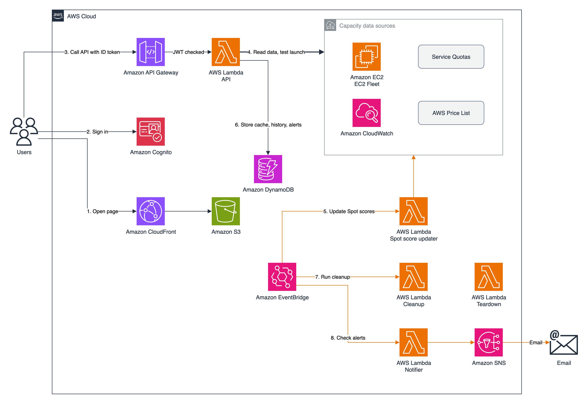

# GPU Capacity Finder

> 本文件是[英文版 README](README.md) 的直譯，未增減任何內容。如有出入，以英文版為準。

GPU Capacity Finder 是一個小型的決策輔助 Web 應用程式，您可以部署在自己的 AWS 帳戶中，用來尋找 Amazon Elastic Compute Cloud（Amazon EC2）上的 GPU 容量。一個頁面顯示各項公開的容量訊號：Capacity Block 方案、Spot 放置分數、Spot 價格、隨需定價，以及服務配額與其用量。您可以用一次有界限的測試啟動來確認某個訊號，並設定選用的電子郵件提醒。此頁面不管理執行個體、不預留容量，也不啟動您的工作負載。當您決定採取行動時，您可以在 EC2 主控台購買 Capacity Block，而頁面會提供建立 Capacity Reservation 的 AWS Command Line Interface（AWS CLI）命令，由您自行執行。

## 解決的問題

P5 和 P6 等 GPU 執行個體的需求很高。您經常會問：有沒有 Capacity Block 可用？什麼時候？在這個區域使用 Spot 是否可能成功？隨需現在有容量嗎？我的配額夠嗎？公開的 AWS API 可以回答第一、第二和第四個問題。沒有任何 API 會回報隨需容量，因此測試啟動會請求一個執行個體，在啟動呼叫之後立即終止它，並將結果保留為歷史記錄。

## 架構



1. 您從 Amazon CloudFront 分佈開啟頁面。頁面是儲存在私有 Amazon Simple Storage Service（Amazon S3）儲存貯體中的靜態 HTML 和 JavaScript。
2. 您透過 Amazon Cognito 託管頁面登入。自助註冊已關閉，每位使用者都由管理員建立，並要求使用驗證器應用程式進行多重要素驗證（MFA）。
3. 頁面使用您的 ID 權杖呼叫 Amazon API Gateway HTTP API。JSON Web Token（JWT）授權方會先檢查權杖，AWS Lambda 中的 API 函式才會執行。
4. API 函式讀取已啟用區域中的 Amazon EC2、Service Quotas、Amazon CloudWatch 和 AWS Price List 資料，並以 EC2 Fleet 執行測試啟動。
5. Spot 分數更新函式依 Amazon EventBridge 排程每 15 分鐘執行一次，並在 00:30 UTC 進行每日更新。它是唯一會建立 Spot 放置分數請求的程式碼。
6. Amazon DynamoDB 資料表儲存共用快取（方案、分數、價格和配額）、測試啟動歷史記錄，以及電子郵件提醒。
7. 清理函式每 15 分鐘終止殘留的測試執行個體，拆除函式則在您刪除堆疊時移除測試資源。
8. 通知函式依排程檢查提醒，並透過 Amazon Simple Notification Service（Amazon SNS）主題寄送電子郵件。

本範例以 Python 撰寫基礎設施（AWS Cloud Development Kit，簡稱 AWS CDK）、Lambda 函式和測試。頁面是純 JavaScript，不需要建置步驟。

## 先決條件

- 一個 AWS 帳戶，以及可以部署堆疊的憑證。請使用非生產帳戶。
- 每個 AWS 帳戶只部署一份本範例。原因請參閱[拆除](#拆除)。
- AWS CLI 第 2 版、Node.js 20 或更新版本並執行 `npm install -g aws-cdk`，以及 Python 3.12 或更新版本。
- 已在部署區域對 CDK 執行 bootstrap。在範例根目錄執行 `python3 -m venv .venv && source .venv/bin/activate && pip install -r requirements.txt && cdk bootstrap`。
- 在每個您想執行測試啟動的區域中，有一個預設虛擬私有雲端（VPC）。若要建立，請執行 `aws ec2 create-default-vpc --region <Region>`。
- 若要執行 Spot 測試啟動，需要 Spot 存取權限與 Spot 服務連結角色：`aws iam create-service-linked-role --aws-service-name spot.amazonaws.com`。如果您的帳戶無法使用 Spot，請設定 `testLaunchAllowSpot=false`。

## 部署

在範例根目錄執行：

```bash
export AWS_PROFILE=<profile>   # or sign in another way
export AWS_REGION=<region>
./deploy.sh
```

指令碼會建立 Python 環境，請您確認帳戶和區域，然後執行 `cdk deploy`。請在指令碼名稱之後傳入設定，例如 `./deploy.sh -c excludeRegions=me-south-1`。如果您要升級由較早版本建立的堆疊，請先閱讀[升級](docs/admin-guide.zh-tw.md#升級)：當您傳入已移除或已重新命名的設定時，部署會停止。

部署會輸出 `SiteUrl` 和 `UserPoolId`。建立您的第一位使用者：

```bash
aws cognito-idp admin-create-user --region <StackRegion> --user-pool-id <UserPoolId> \
  --username you@example.com \
  --user-attributes Name=email,Value=you@example.com Name=email_verified,Value=true \
  --desired-delivery-mediums EMAIL
```

開啟 `SiteUrl`，以臨時密碼登入，設定新密碼，並註冊驗證器應用程式。

若要執行單元測試，請在 Python 環境中執行 `pip install -r requirements-dev.txt && pytest`。

### 設定

以 `-c key=value` 傳入每項設定。每次部署時請傳入相同的設定。[管理員指南](docs/admin-guide.zh-tw.md#設定)說明何時變更各項設定。

| 鍵 | 預設值 | 意義 |
|---|---|---|
| `stackName` | `gpu-capacity-finder` | 最多 40 個英文字母、數字和連字號，以字母開頭，不含 `aws`、`amazon` 或 `cognito` |
| `excludeRegions` | 無 | 最多 40 個要排除在各項功能之外的已啟用區域。`us-east-1` 會被拒絕，因為 Spot 分數請求會送到它的端點 |
| `spotScoreFamilies` | `g6e.*`、`g7.*`、`g7e.*`、`p5.*`、`p5e.*`、`p5en.*`、`p6-b200.*`、`p6-b300.*` | 最多 20 個模式，指定要取得 Spot 分數的系列。請參閱[選擇 Spot 分數系列](#選擇-spot-分數系列) |
| `spotScoreConfigsPerDay` | `40` | 1 到 100。24 小時內使用中的不同 Spot 分數請求設定的最大數量 |
| `spotScoreCacheMinutes` | `15` | 15 到 240。分數保持為最新的分鐘數 |
| `enableTestLaunch` | `true` | `false` 會移除測試啟動、其權限，以及清理和拆除函式 |
| `testLaunchAllowSpot` | `true` | `false` 會隱藏並拒絕 Spot 測試啟動 |
| `testLaunchCooldownMinutes` | `15` | 1 到 1440。在此時間內重複的測試會傳回先前的結果 |
| `maxTestLaunchesPerUserPerDay` | `50` | 0 到 1000。每位使用者每個 UTC 日的測試啟動次數；`0` 會關閉此上限 |
| `maxTestLaunchesPerDay` | `100` | 0 到 10000。整個部署每個 UTC 日的測試啟動次數；`0` 會關閉此上限 |
| `enableNotifications` | `true` | `false` 會移除提醒資料表、SNS 主題、通知函式和**提醒**索引標籤 |
| `notifyIntervalMinutes` | `15` | 5 到 1440。兩次提醒檢查之間的分鐘數 |
| `maxSubscriptionsPerUser` | `10` | 1 到 20。每位使用者的提醒數量 |
| `offeringCacheHours` | `6` | 1 到 48。方案清單保留在快取中的小時數 |
| `quotaCacheMinutes` | `30` | 1 到 60。一個區域的配額保留在快取中的分鐘數 |
| `apiRateLimit` | `10` | 1 到 100。每秒 API 請求數，由使用者共用；突發量為此值的三倍 |
| `sessionHours` | `12` | 1 到 720。下次完整登入之前的小時數 |
| `alarmTopicArn` | 未設定 | 您擁有的 SNS 主題的 ARN，位於堆疊區域，用於 CloudWatch 警示。請參閱[警示](docs/admin-guide.zh-tw.md#警示) |

兩個每日測試啟動上限都設為 `0` 時，只剩冷卻時間和 API 速率限制會限制測試啟動的次數，也就是限制它們的費用。

各項功能使用您的帳戶已啟用的商業區域，扣除 `excludeRegions`。您啟用的區域會在一天內出現，不需要重新部署。請參閱[區域](docs/admin-guide.zh-tw.md#區域)。

### 選擇 Spot 分數系列

AWS 會限制一個帳戶在 24 小時內可發出的不同 Spot 放置分數請求數量，而帳戶中的所有項目共用這項限制。每個取得分數的系列，每種 GPU 數量以及每 10 個提供它的區域，就會使用一個請求。為每個區域中的每種 GPU 類型取得分數會超過這項限制，因此請只在 `spotScoreFamilies` 中列出您需要的 GPU 系列。若要變更預設清單，請傳入完整清單，並依您的 shell 加上引號：

```bash
./deploy.sh -c 'spotScoreFamilies=g6e.*,p5en.*,p6-b200.*'
```

每個模式以 `g` 或 `p` 系列字母及其世代數字開頭，並包含點、星號或問號，例如 `g6e.*` 或 `p5*`。沒有世代數字的模式（例如 `g*`）會被拒絕。

- **自動更新。** 已取得分數之系列的新尺寸，以及您啟用的區域或開始提供某個尺寸的區域，會在下次每日更新時加入其分數群組。供應、價格、配額、測試啟動和 Capacity Block 涵蓋各個 GPU 系列，並自行納入新系列。
- **需要變更並重新部署。** 新系列在您將其加入 `spotScoreFamilies` 並重新部署之前，不會取得 Spot 分數。

更新週期請參閱 [Spot 分數如何保持最新](docs/admin-guide.zh-tw.md#spot-分數如何保持最新)。

## 使用

頁面有六個索引標籤：**Spot 分數**、**隨需與 Spot**、**Capacity Block**、**配額**、**提醒**（僅在開啟電子郵件提醒時出現）和**使用者**。同一部署的使用者共用相同的結果。

- **Spot 分數**以表格或地圖，比較每個分數群組（一個系列搭配一種 GPU 數量）在各區域的情況。
- **隨需與 Spot**顯示一個區域中的一種類型：隨需定價、Spot 分數、各可用區域的 Spot 價格，以及測試啟動面板。測試啟動會回報 EC2 挑選的可用區域和尺寸，或說明它為什麼找不到容量。可用區域列上的**使用 CLI 預留**會提供一個建立隨需容量預留（On-Demand Capacity Reservation）的 AWS CLI 命令：它在該可用區域為該類型保留一個執行個體的容量一小時，並依隨需費率計費，直到它結束或您取消為止。此頁面不會替您建立。
- **Capacity Block**搜尋方案，並將每個方案連結到 EC2 主控台，供您在那裡購買。
- **配額**顯示一個區域的隨需、Spot 和 Capacity Block 配額及其用量。用量來自 Amazon CloudWatch，新執行個體可能要幾分鐘後才會顯示。頁面顯示過去一小時內的最高值，並保留最多 `quotaCacheMinutes` 分鐘；選擇**重新整理**即可再次查詢。
- **提醒**會在有方案出現或 Spot 分數達到您的門檻時寄電子郵件給您。提醒每次從無法使用變成可用時寄一封電子郵件。訊號降到門檻以下後又回來時，您會再收到一封，例如門檻為 4，而分數在 3 和 4 之間變動。
- **使用者**說明如何在 Amazon Cognito 主控台中管理使用者。

[使用者指南](docs/user-guide.zh-tw.md)說明每個索引標籤並提供實際情境，[管理員指南](docs/admin-guide.zh-tw.md)涵蓋設定、使用者、監控和升級。另有簡體中文（[README](README.zh-cn.md)、[使用者指南](docs/user-guide.zh-cn.md)、[管理員指南](docs/admin-guide.zh-cn.md)）和繁體中文（[README](README.zh-tw.md)、[使用者指南](docs/user-guide.zh-tw.md)、[管理員指南](docs/admin-guide.zh-tw.md)）的直譯版本。

## 拆除

本範例中的資源在執行期間會產生費用，包括測試啟動所啟動的 GPU 執行個體。隨需測試啟動會依其類型的最短計費期間計費。

```bash
source .venv/bin/activate   # the CDK app needs the Python environment that deploy.sh creates
cdk destroy                 # add -c stackName=<name> if you deployed with a custom stack name
```

`cdk destroy` 會移除 S3 儲存貯體內容、DynamoDB 資料表、SNS 主題及其訂閱、使用者集區，以及函式的日誌群組。當測試啟動開啟時，拆除自訂資源會終止執行中的測試執行個體，並移除已啟用區域（扣除 `excludeRegions`）中的探測啟動範本和探測安全群組。失敗的區域不會阻擋刪除。刪除之後，請檢查：

- 每個您執行過測試啟動之區域中的**探測資源**：帶有 `gpu-capacity-finder-probe` 標籤的執行個體和啟動範本，以及帶有 `gpu-capacity-finder-probe-sg` 標籤的安全群組。如果您在某個區域測試之後才將它排除，自訂資源會略過該區域。
- **DynamoDB 系統備份。** DynamoDB 會將每個已刪除資料表的系統備份保留 35 天，而提醒資料表的備份含有使用者的電子郵件地址。
- **CDK 輔助函式的日誌群組。**
- 使用者在 EC2 主控台購買的 **Capacity Block**，以及使用者以複製的命令建立的 **Capacity Reservation**。堆疊不擁有它們，它們會持續計費。

[管理員指南](docs/admin-guide.zh-tw.md#拆除)提供每項檢查的命令。

每個 AWS 帳戶只使用一份本範例的部署。探測資源使用固定的標籤名稱，而清理和拆除函式會掃描帳戶的已啟用區域，因此在同一帳戶中的第二個部署（即使在另一個區域）會清理掉第一個部署的測試資源。AWS 對 Spot 放置分數請求的限制也由整個帳戶共用。

## 限制

- Spot 放置分數是估計值，群組分數描述的是整個群組，而不是單一尺寸。高分不代表必定能啟動，低分也仍可能啟動。
- 本範例無法提高 AWS 對 Spot 分數請求的限制（請參閱[選擇 Spot 分數系列](#選擇-spot-分數系列)）。
- 容量結果是特定時間點的結果。電子郵件提醒依排程檢查，因此訊號可能在兩次檢查之間出現又消失。
- 價格是定價與最新的 Spot 價格。您實際支付的金額可能不同，例如有折扣或 Savings Plans 時。
- 測試啟動使用預設 VPC，在沒有預設 VPC 的區域中會關閉。
- 配額用量可能延遲幾分鐘，且只涵蓋您部署所在的帳戶。若有多個帳戶，請在每個帳戶各部署一份。
- 此頁面沒有 AWS WAF Web 存取控制清單（Web ACL）、沒有自訂網域，也沒有存取日誌。在廣泛分享此頁面之前，請先加入這些項目。

## 安全性

每個 AWS Identity and Access Management（IAM）角色的權限都限縮於其函式。API 函式具有唯讀的 Amazon EC2、Service Quotas、CloudWatch 和 Price List 動作。它的測試啟動權限要求探測標籤、`g*` 或 `p*` 執行個體類型、Amazon 擁有的映像，以及帶有標籤的探測安全群組。沒有任何角色可以建立 Capacity Reservation 或購買 Capacity Block。[管理員指南](docs/admin-guide.zh-tw.md#安全性注意事項)列出每項權限。

如需詳細資訊，請參閱 [CONTRIBUTING](CONTRIBUTING.md#security-issue-notifications)。

## 授權

本程式庫依 MIT-0 授權條款授權。請參閱 [LICENSE](LICENSE) 檔案。

區域地圖的世界輪廓來自 Natural Earth，屬於公有領域。請參閱 [THIRD-PARTY-LICENSES](THIRD-PARTY-LICENSES) 檔案。
